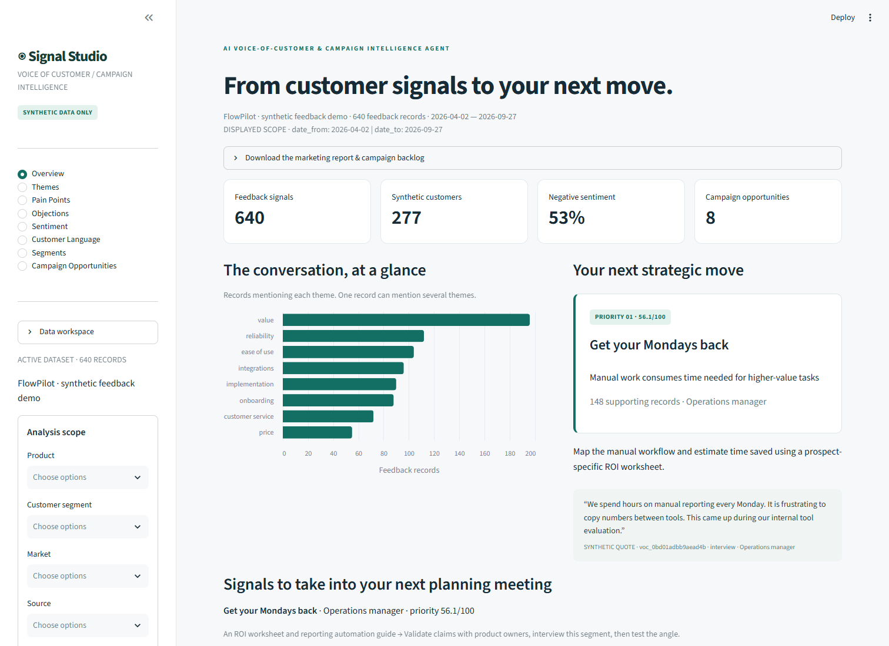
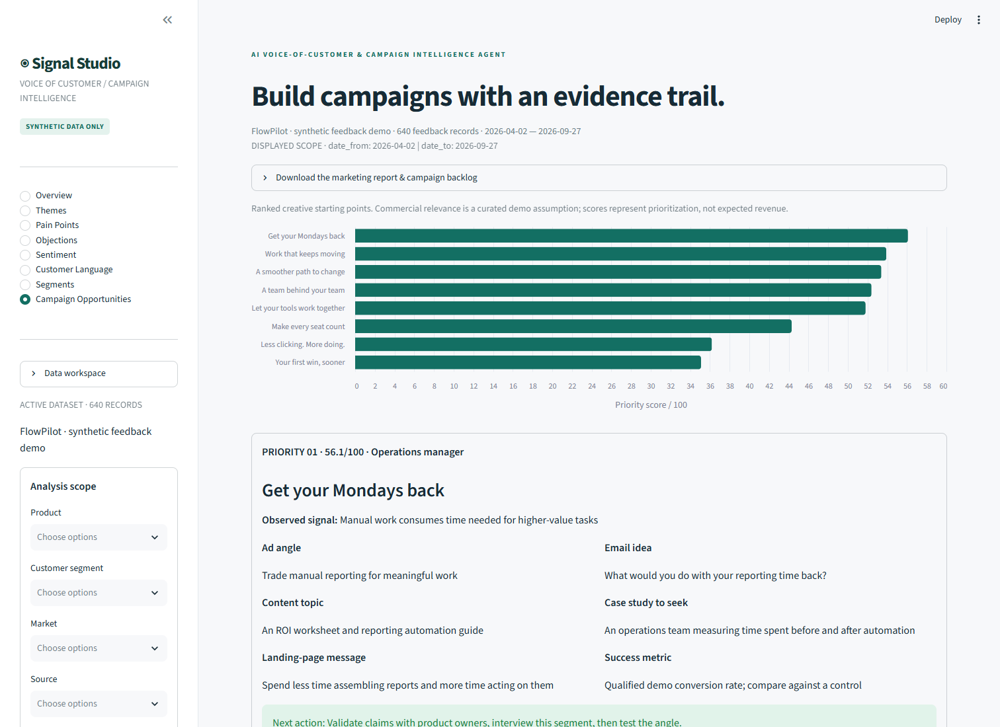
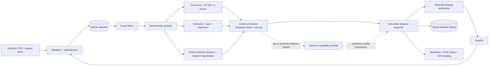
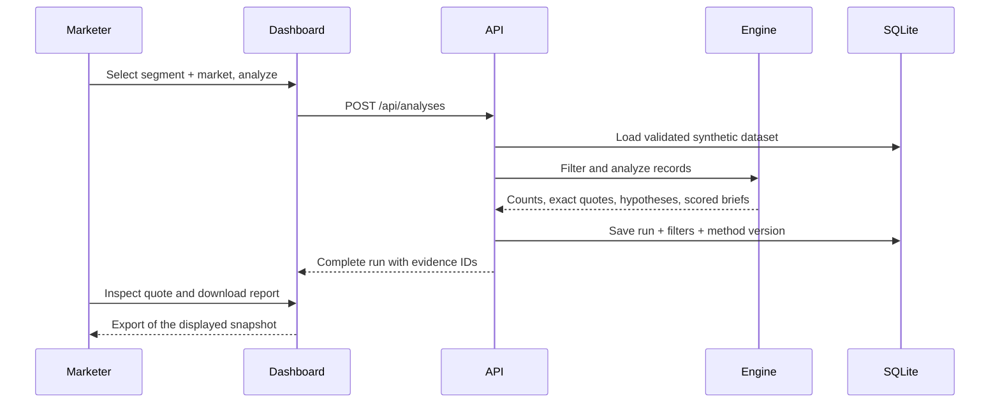
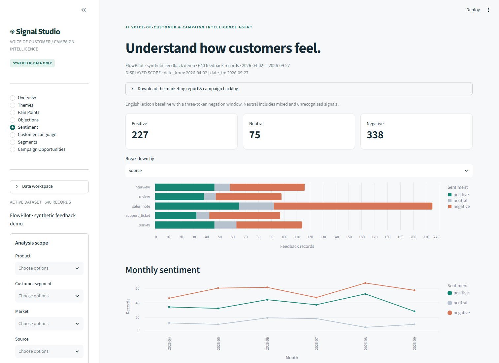

# AI Voice-of-Customer & Campaign Intelligence Agent

[](https://github.com/oguz-basdemir/ai-voc-campaign-intelligence/actions/workflows/ci.yml)
[](LICENSE)

**Turn qualitative feedback into evidence-backed marketing decisions.** Signal Studio is a portfolio-ready Python application for product marketers, growth teams, and marketing strategists who need to connect customer pain, objections, and language to their next campaign brief.

**All demo customer data is synthetic.** FlowPilot, its customers, feedback, products, and quotes are fictional. The app accepts only uploader-attested synthetic CSVs. The attestation is a user declaration, not an automated provenance check.



## Try it locally

Python 3.11+ is required. No API key is needed for the complete deterministic demo.

```bash
git clone https://github.com/oguz-basdemir/ai-voc-campaign-intelligence.git
cd ai-voc-campaign-intelligence
python -m venv .venv
# macOS / Linux
source .venv/bin/activate
# Windows PowerShell
.venv\Scripts\Activate.ps1

python -m pip install -e '.[dev]'
cp .env.example .env
# PowerShell alternative: Copy-Item .env.example .env
python -m uvicorn voc.api:app --host 127.0.0.1 --port 8000
```

In a second terminal, activate the same environment and run:

```bash
python -m streamlit run app.py --server.address 127.0.0.1 --server.port 8501
```

Open [the dashboard](http://127.0.0.1:8501) and [interactive API docs](http://127.0.0.1:8000/docs). The dashboard automatically loads and analyzes 640 synthetic feedback records. If either port is busy, use another port and set `VOC_API_URL` to the API address in `.env`.

`requirements.lock.txt` records the tested dependency versions. For a reproducible install, use `python -m pip install -c requirements.lock.txt -e '.[dev]'`. Docker applies these constraints to runtime dependencies. The lock includes development packages; constraints do not install them unless requested.

### Docker

```bash
docker compose up --build
```

Two non-root services share one image. The API owns SQLite in the `voc-data` volume; Streamlit calls the API over the Compose network. Health checks gate dashboard startup. Ports are bound to localhost. Stop with `docker compose down`; the volume preserves datasets and analysis history. Docker support is included; see `docs/VALIDATION.md` for what was actually verified locally.

## A realistic strategy workflow

1. Load the synthetic FlowPilot demo or import a synthetic CSV in **Data workspace**.
2. Choose product, customer segment, market, source, and date range. Select **Analyze feedback** to create an immutable scoped run.
3. Use **Overview** to identify the strongest signals. Inspect themes, pain points, and objection quotes before choosing a message.
4. Visit **Customer Language** for repeated phrases, and **Segments** for needs, motivations, explicit desired-outcome quotes, and persona hypotheses.
5. Open **Campaign Opportunities** to compare scores, brief a campaign, and select an experiment. Each brief includes an ad angle, content topic, landing-page message, email idea, case-study opportunity, next action, and suggested KPI.
6. Download the **Voice of Customer Marketing Report** in Markdown or printable HTML, plus the campaign backlog as CSV. Restore earlier runs from the methodology/history panel.

Navigation has all eight requested views: Overview, Themes, Pain Points, Objections, Sentiment, Customer Language, Segments, and Campaign Opportunities. Draft filters do not change a displayed run until analysis is submitted. The displayed scope and every export use that run's saved filters.



## Architecture





```text
ai-voc-campaign-intelligence/
├── app.py                    # Streamlit workspace, API client, visualizations
├── voc/
│   ├── api.py                # HTTP ingestion, analysis, history, exports
│   ├── ingestion.py          # CSV validation, stable IDs, filtering
│   ├── analysis.py           # Themes, clusters, sentiment, evidence, scoring
│   ├── taxonomy.py           # Inspectable rules and campaign templates
│   ├── llm.py                # Provider protocol, compatible adapter, validation
│   ├── repository.py         # SQLite snapshots and dataset persistence
│   ├── report.py             # Safe Markdown, printable HTML, CSV
│   ├── service.py            # Shared analysis orchestration
│   ├── models.py             # Typed request / enrichment contracts
│   └── synthetic.py          # Reproducible fictional data generator
├── data/synthetic_feedback.csv
├── tests/                    # Deterministic, ingestion, API, LLM, export tests
├── scripts/                  # Example exports and browser verification
├── docs/                     # Screenshots, example reports, validation record
├── .github/workflows/ci.yml
├── .env.example
├── Dockerfile
└── compose.yaml
```

## CSV contract

UTF-8 or UTF-8 with BOM. Required columns:

| Column | Example | Meaning |
| --- | --- | --- |
| source | `interview` | `review`, `survey`, `support_ticket`, `sales_note`, `interview` |
| customer_id | `SYN-0042` | Fictional customer identifier |
| date | `2026-06-12` | Valid date in YYYY-MM-DD format |
| customer_type | `Operations manager` | Customer segment / role |
| text | `We spend hours on manual reporting every Monday.` | Synthetic feedback, maximum 5,000 characters |
| market | `Nordics` | Market label |
| product | `FlowPilot Automate` | Fictional product label |

Uploads are limited to 5 MB and 10,000 records; metadata fields to 120 characters. All required values must be nonblank. Unknown sources and invalid dates are rejected with actionable errors. Additional columns are ignored. Whitespace is trimmed; exact duplicate rows are removed. Each accepted record gets a stable SHA-256-derived ID. The ingestion summary reports accepted rows and duplicate counts. The system does not merge merely similar feedback or deduplicate different records from the same customer.

Regenerate examples:

```bash
python -m voc.synthetic --rows 640 --seed 42
python scripts/export_demo.py
```

The generator deliberately creates mixed positive, negative, evaluative, and goal-oriented language across five sources, four role segments, four markets, two products, and six months. It is useful for demonstrating the workflow, not benchmarking model accuracy. Repeated templates make phrase recurrence stronger than typical real research data.

## Methodology

### Themes and discovery

The multi-label taxonomy uses word-boundary term matching for **price, onboarding, ease of use, integrations, customer service, reliability, implementation, and value**. A record can count once toward multiple themes; theme shares therefore need not sum to 100%. Unmatched records remain visible in the evidence ledger and summary.

An independent TF-IDF pipeline uses English stop words, unigrams/bigrams, sublinear term frequency, and up to 3,000 features. K-means uses seed 42 and ten initializations; the requested 2–12 clusters are bounded by distinct vectors. Top centroid terms act as exploratory labels. Tiny or empty-vocabulary datasets return no clusters. Clusters group vocabulary; they are not validated semantic findings.

### Sentiment, pain, objections, and goals

Sentiment uses an inspectable English positive/negative lexicon and a three-token negation window with contrast-word boundaries. Positive/negative sums map to positive/negative sentiment; ties and unrecognized signals are neutral. Breakdowns cover source, product, segment, market, and monthly trends.

Negative sentiment is the baseline proxy for a pain record. Pain labels are curated by matched theme. Severity is a keyword heuristic: 1 mild, 2 friction, 3 critical. Pain cards expose frequency, average severity, segments, and exact source quotes.

Objection candidates use concern, hesitation, evaluation-question, and cost patterns. They can come from any source and are separate from sentiment. Their responses are recommended conversations, not claims about product features. Phrase extraction uses recurring contiguous 3–5 word spans, rejects sentence crossings, counts once per record, and groups phrases into problems, benefits, and desired outcomes. Exact goal clauses are shown in segment profiles; motivations and needs are theme-derived hypotheses.



### Personas and campaigns

Persona labels come from the dominant theme within each existing segment. Top themes inform needs, motivations, and messaging; objection candidates and goal quotes provide supporting context. Profiles always state **generated hypothesis based on available synthetic data**. “Directional” and “Limited” labels indicate sample volume (30-record threshold), not statistical confidence.

Campaign briefs use curated strategist-written templates linked to negative or objection records. Positive-only themes do not automatically create pain-led campaigns. Case-study opportunities describe evidence to seek, not fabricated successes. Recommendations include a validation action and a suggested experiment KPI rather than unsupported performance promises.

### Transparent prioritization

```text
frequency            = signal records / filtered records × 100
severity             = average signal severity / 3 × 100
commercial relevance = curated theme coefficient × 100
segment size         = distinct customer IDs in largest affected segment /
                       all distinct customer IDs in scope × 100

priority = 0.35 × frequency + 0.30 × severity
         + 0.20 × commercial relevance + 0.15 × segment size
```

Signals are the union of negative and objection records, avoiding double counting within a theme. The largest affected segment is selected by signal-record count. Components are rounded to two decimals, with the final score rounded to one. Commercial relevance coefficients in `voc/taxonomy.py` are **demo assumptions, not measured revenue**. Frequencies measure feedback volume, and segment sizes measure distinct synthetic customer IDs. A customer can occur in several segments. This is a directional prioritization tool, not a revenue forecast.

## Optional LLM enrichment

Configure `.env` with `VOC_LLM_BASE_URL`, `VOC_LLM_API_KEY`, and `VOC_LLM_MODEL`, then explicitly enable enrichment in the sidebar or set `enrich: true` in an analysis request. Base URLs must expose `/chat/completions` and support JSON mode. Default configuration targets an OpenAI-compatible interface; another compliant provider can be substituted through the `LLMProvider` protocol.

The provider receives a bounded packet of up to three representative synthetic quotes per matched theme, truncated to 1,200 characters each, with evidence IDs. It proposes theme-associated campaign headlines and rationales. Pydantic validates output shape; each evidence ID must occur in the supplied theme's packet. These checks verify references, **not semantic correctness of a generated claim**. Untrusted feedback is framed as quoted data; human review remains necessary. LLM suggestions never replace deterministic counts, classifications, or scores.

Timeouts, authentication failures, malformed JSON, bad schemas, and invented evidence IDs preserve the deterministic run and show an enrichment-unavailable message. No live paid provider call is needed in the test suite. Enrichment is creative hypothesis generation, not a second validated classifier.

Reference interfaces: [FastAPI file uploads](https://fastapi.tiangolo.com/tutorial/request-files/), [Streamlit documentation](https://docs.streamlit.io/), and [Chat Completions API](https://platform.openai.com/docs/api-reference/chat/create).

## Example outputs

The default seeded demo surfaces manual work and value concerns. One synthetic source quote is:

> We spend hours on manual reporting every Monday. It is frustrating to copy numbers between tools.

The corresponding campaign concept is **“Get your Mondays back”**, with an ROI worksheet, reporting automation content, a landing-page message about acting on reports, and a case-study opportunity measuring time spent before and after automation. Its exact supporting records and score components are inspectable in the dashboard and saved run.

- [Voice of Customer Marketing Report — Markdown](docs/examples/voice-of-customer-report.md)
- [Printable marketing report — HTML](docs/examples/voice-of-customer-report.html)
- [Campaign opportunity backlog — CSV](docs/examples/campaign-opportunities.csv)
- [Customer Language Library screenshot](docs/screenshots/customer-language.png)

## API

| Method | Endpoint | Result |
| --- | --- | --- |
| GET | `/health` | Liveness and synthetic-only flag |
| POST | `/api/demo` | Idempotent synthetic dataset creation |
| POST | `/api/datasets` | Multipart `file` + `synthetic=true` |
| GET | `/api/datasets` | Saved dataset metadata |
| GET | `/api/datasets/{id}` | Dataset options and ingestion stats |
| POST | `/api/analyses` | Persisted analysis with filters and evidence |
| GET | `/api/datasets/{id}/analyses` | Latest 20 saved runs |
| GET | `/api/analyses/{id}` | Complete analysis snapshot |
| GET | `/api/analyses/{id}/report?format=md` | Download Markdown; `html` also supported |
| GET | `/api/analyses/{id}/opportunities.csv` | Campaign backlog |

Example request after obtaining the dataset ID from `/api/demo`:

```json
{
  "dataset_id": "ds_<returned-id>",
  "filters": {
    "sources": ["interview", "sales_note"],
    "products": ["FlowPilot Automate"],
    "segments": ["Operations manager"],
    "markets": ["Nordics"],
    "date_from": "2026-04-01",
    "date_to": "2026-09-30"
  },
  "clusters": 6,
  "enrich": false
}
```

Empty scopes return an empty, exportable run. Invalid filters return 422, missing resources 404. Analyses are synchronous; the API executes the CPU pipeline in FastAPI's worker thread. SQLite uses parameterized queries, transactions, and WAL mode. This is designed for a local demo and small teams, not high-concurrency deployment.

## Testing and quality

```bash
python -m pytest -q
ruff check .
ruff format --check .

# Start both services before running browser checks:
python -m playwright install chromium
python scripts/capture_dashboard.py
# Or use installed Chrome:
python scripts/capture_dashboard.py --channel chrome
```

Tests cover synthetic reproducibility, malformed uploads, limits, deduplication, inclusive filtering, sentiment negation, multi-label themes, empty/sparse data, cluster reproducibility, evidence provenance, scoring, API persistence, scoped exports, synthetic attestation, mocked provider HTTP behavior, schema/reference validation, HTML escaping, and CSV formula safety. The browser script checks all eight views, downloads a report, applies a segment filter, and captures genuine screenshots. CI runs unit/API tests and lint on Python 3.11, 3.12, and 3.14; the local validation record identifies the environment actually tested.

## Privacy and limitations

- **Use synthetic data only.** No CRM, ticketing, or interview platform is connected in this demo. Do not upload real customer records.
- Synthetic-only attestation cannot detect disguised real data. A production ingestion layer needs consent, provenance controls, access policies, and redaction.
- SQLite stores raw synthetic feedback and analysis snapshots in plaintext. There is no authentication, tenancy, encryption, retention scheduler, or production deletion workflow. Keep the demo on localhost.
- LLM enrichment is off by default. Enabling it sends selected synthetic quotes to your configured provider; review that provider's terms and avoid logging keys or sensitive content. `.env` and databases are excluded from Git and Docker builds.
- Lexicons miss sarcasm, nuance, multilingual feedback, long-range negation, and implicit objections. Theme keywords may match context that is not the intended topic. Goals can contain negative words and therefore register as pain.
- Curated campaign templates and persona names are interpretable starting points, not evidence of product capabilities. Commercial relevance and severity are assumptions. Validate claims and test messages before launch.
- Synthetic templates and sampling imbalance inflate recurrence. Frequency is not market prevalence; multiple records from one customer can influence theme counts. There is no statistical uncertainty estimate or labeled accuracy benchmark.
- LLM evidence validation prevents unknown references but cannot establish factual entailment or fully eliminate prompt injection.
- Files are bounded to 5 MB / 10,000 rows; large production streams need asynchronous jobs, pagination, and scalable storage. Local HTTP has no authentication or rate limiting.

## Future CRM and support integrations

Potential adapters: HubSpot / Salesforce sales notes, Zendesk / Intercom support tickets, survey exports, and interview transcript platforms. Each adapter should map into the seven-column contract, use read-only OAuth scopes, preserve source IDs and timestamps, and implement idempotent incremental sync. Production work should add PII redaction, tenant authorization, explicit retention/deletion controls, auditable provenance, and a review queue before sending data to any LLM.

Other extensions: labeled evaluation sets, multilingual sentiment, semantic embeddings, analyst-edited taxonomies, phrase-level context classification, confidence intervals, revenue-calibrated relevance, experiment tracking, and background workers with PostgreSQL. These integrations are a roadmap; no real accounts or data are used here.

MIT licensed. See [LICENSE](LICENSE).
